# DevOps Tech Challenge — React + Express on Amazon ECS Fargate

## Overview

This project deploys a **React frontend** and **Express/Node.js backend** to AWS using a containerized, Infrastructure-as-Code, and GitOps workflow.

The final solution uses:

- **Docker** for application packaging
- **Terraform** for AWS infrastructure
- **Amazon ECR** for container images
- **Amazon ECS with AWS Fargate** for serverless container compute
- **Application Load Balancer** for public traffic and path-based routing
- **Amazon CloudWatch** for logs and service metrics
- **ECS Service Auto Scaling** for CPU-based horizontal scaling
- **GitHub Actions** for CI/CD
- **GitHub OIDC + AWS IAM** for short-lived AWS authentication

The final application is publicly accessible through an AWS Application Load Balancer, with deployments automated from the `gitops` branch.

---

## Quick Links

- [Architecture](#final-architecture)
- [Local Setup](#1-local-application-setup)
- [Docker](#2-docker-containerization)
- [Terraform](#3-terraform-infrastructure)
- [ECS/Fargate](#7-amazon-ecs-and-aws-fargate)
- [Auto Scaling](#10-ecs-service-auto-scaling)
- [GitHub Actions GitOps](#11-github-actions-gitops-pipeline)
- [Reproducing the Deployment](#13-reproducing-the-deployment)
- [Submission](#submission)

---

## Submission Requirements

This repository is structured to satisfy the challenge submission requirements:

- All code and project assets are version controlled in GitHub.
- The repository contains installation and execution instructions.
- The frontend and backend are Dockerized.
- The application was validated locally before AWS deployment.
- Terraform is used to provision the AWS application infrastructure.
- GitHub Actions automates application deployment from the `gitops` branch.
- The final submission should include a hyperlink to this repository and the public frontend URL.

---

## Final Architecture

The diagram below represents the architecture actually implemented in this project: GitHub Actions GitOps, AWS OIDC/IAM authentication, Terraform-provisioned infrastructure, ECR, an internet-facing ALB, ECS Fargate services, CloudWatch, security groups, and CPU-based ECS Service Auto Scaling.


### Architecture Flow

```text
Developer
   ↓
GitHub Repository — gitops branch
   ↓
GitHub Actions
   ↓
GitHub OIDC → AWS IAM deployment role
   ↓
Build and tag frontend/backend Docker images
   ↓
Amazon ECR
   ↓
Register new ECS task definition revisions
   ↓
Update ECS Fargate services
   ↓
Application Load Balancer
   ├── /       → Frontend target group → Frontend service :80
   └── /api/*  → Backend target group  → Backend service :8080
```

Terraform provisions the AWS infrastructure, while CloudWatch provides container logs and ECS metrics. Both ECS services use target-tracking auto scaling from **1 to 4 tasks** with a **50% CPU target**.


## Technology Stack

| Area | Technology |
| --- | --- |
| Frontend | React |
| Backend | Node.js / Express |
| Containerization | Docker |
| Frontend Web Server | Nginx |
| Infrastructure as Code | Terraform |
| Container Registry | Amazon ECR |
| Container Orchestration | Amazon ECS |
| Compute | AWS Fargate |
| Load Balancing | Application Load Balancer |
| Monitoring | Amazon CloudWatch |
| Auto Scaling | ECS Service Auto Scaling |
| CI/CD | GitHub Actions |
| AWS Authentication | GitHub OIDC + IAM |
| AWS Region | us-east-1 |

---


---

# 1. Local Application Setup

Before containerizing or deploying the application, I first verified that the supplied frontend and backend worked locally.

## Prerequisites

Install:

- Git
- Node.js
- npm
- Docker Desktop
- Terraform
- AWS CLI

For local source execution, Node.js 16 is the safest choice for this legacy application because the project uses older dependencies.

## Clone the repository

```bash
git clone https://github.com/dexter210/devops-ecs-tech-challenge.git
cd devops-ecs-tech-challenge
git checkout gitops
```

## Run the backend locally

```bash
cd backend
npm ci
npm start
```

The backend listens on:

```text
http://localhost:8080
```

## Run the frontend locally

Open another terminal:

```bash
cd frontend
npm ci
npm start
```

The frontend runs on:

```text
http://localhost:3000
```

A successful frontend-to-backend call displays a generated GUID.

### Local validation evidence

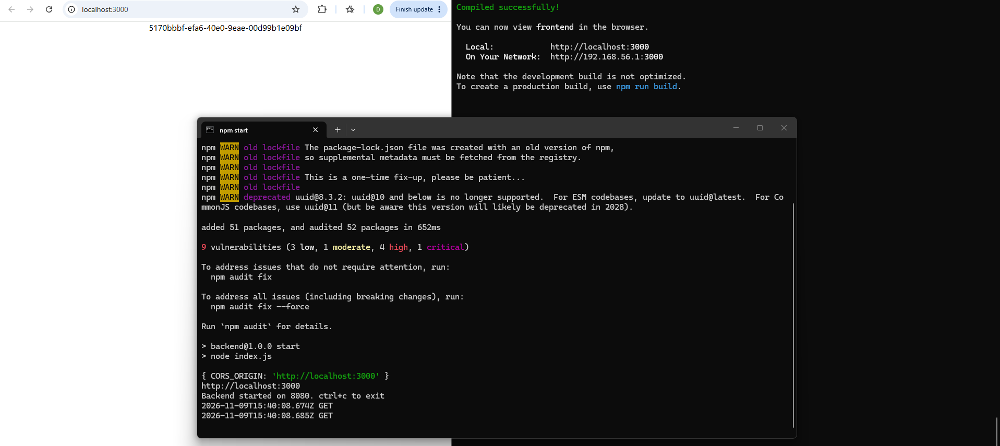

This confirmed that the application worked before introducing Docker or AWS infrastructure.

---

# 2. Docker Containerization

Both application components were containerized.

## Backend Docker image

The backend uses a lightweight Node.js Alpine image.

```dockerfile
FROM node:16-alpine

WORKDIR /app

COPY package*.json ./

RUN npm ci --omit=dev

COPY . .

EXPOSE 8080

CMD ["npm", "start"]
```

Build:

```bash
docker build -t devops-backend:1.0 ./backend
```

## Frontend Docker image

The frontend uses a multi-stage build:

1. Node.js compiles the React application.
2. Nginx serves the static production build.

```dockerfile
FROM node:16-alpine AS build

WORKDIR /app

COPY package*.json ./

RUN npm ci

COPY . .

RUN npm run build

FROM nginx:alpine

COPY --from=build /app/build /usr/share/nginx/html
COPY nginx.conf /etc/nginx/conf.d/default.conf

EXPOSE 80

CMD ["nginx", "-g", "daemon off;"]
```

Build:

```bash
docker build -t devops-frontend:3.0 ./frontend
```

## Local container validation

The frontend and backend were started locally and validated before being pushed to AWS.

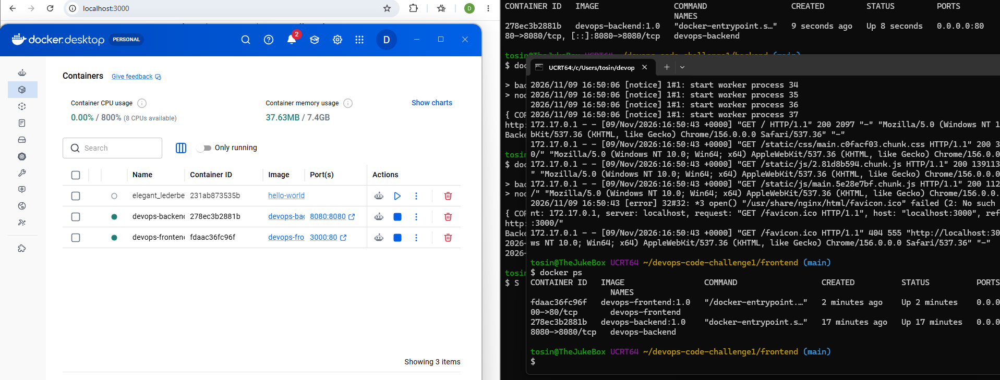

The local Docker network was useful during development, but AWS production routing was later moved to the Application Load Balancer.

---

# 3. Terraform Infrastructure

Terraform provisions the AWS infrastructure for the application.

The configuration is separated by responsibility:

- `networking.tf` — VPC, subnets, Internet Gateway, routes
- `security-groups.tf` — ALB and ECS security groups
- `ecr.tf` — frontend and backend ECR repositories
- `alb.tf` — ALB, target groups, listener, routing rule
- `ecs.tf` — ECS cluster, task definitions, services
- `iam.tf` — ECS task execution role
- `cloudwatch.tf` — CloudWatch log groups
- `autoscaling.tf` — Application Auto Scaling targets and policies
- `outputs.tf` — useful deployment values

## Initialize Terraform

```bash
cd terraform
terraform init
terraform validate
```

## Review the plan

```bash
terraform plan
```

## Bootstrap ECR repositories first

Because the ECS task definitions reference Docker images, create the ECR repositories first:

```bash
terraform apply \
  -target=aws_ecr_repository.frontend \
  -target=aws_ecr_repository.backend
```

Then authenticate Docker to ECR:

```bash
aws ecr get-login-password --region us-east-1 | \
docker login --username AWS --password-stdin 930702873975.dkr.ecr.us-east-1.amazonaws.com
```

Tag and push the application images:

```bash
docker tag devops-frontend:3.0 \
930702873975.dkr.ecr.us-east-1.amazonaws.com/devops-tech-challenge-frontend:3.0

docker tag devops-backend:1.0 \
930702873975.dkr.ecr.us-east-1.amazonaws.com/devops-tech-challenge-backend:1.0

docker push 930702873975.dkr.ecr.us-east-1.amazonaws.com/devops-tech-challenge-frontend:3.0
docker push 930702873975.dkr.ecr.us-east-1.amazonaws.com/devops-tech-challenge-backend:1.0
```

## Deploy the remaining infrastructure

```bash
terraform apply
```

Terraform then creates the networking, security groups, ALB, ECS cluster, Fargate task definitions, ECS services, IAM execution role, CloudWatch log groups, and auto scaling resources.

### Terraform deployment evidence

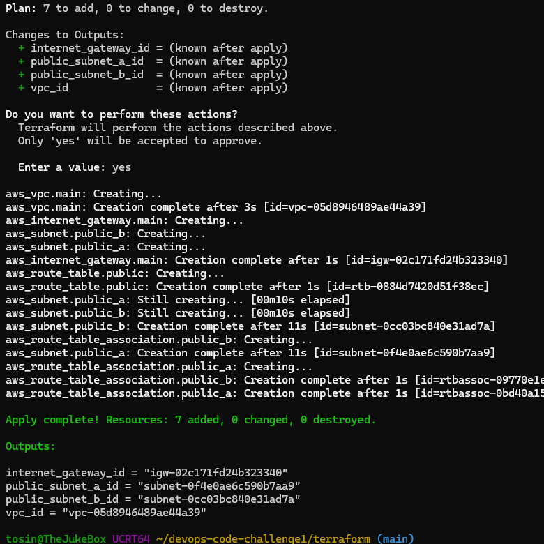

---

# 4. AWS Networking

The application uses a dedicated VPC:

```text
VPC: 10.0.0.0/16

Public Subnet A: 10.0.1.0/24
Public Subnet B: 10.0.2.0/24
```

The public subnets are placed in separate Availability Zones and use a route table with:

```text
0.0.0.0/0 -> Internet Gateway
```

Both Fargate services are deployed across the two public subnets.

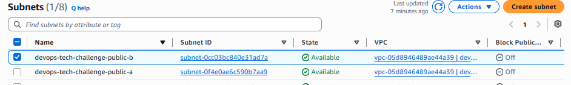

## Security Groups

Two security groups are used.

### ALB Security Group

Allows:

```text
Inbound TCP 80 from 0.0.0.0/0
```

### ECS Security Group

Allows:

```text
TCP 80   only from the ALB security group
TCP 8080 only from the ALB security group
```

This prevents the ECS application ports from being directly opened to arbitrary internet traffic through the security group.

---

# 5. Amazon ECR

Two repositories are used:

```text
devops-tech-challenge-frontend
devops-tech-challenge-backend
```

Terraform created the repositories:

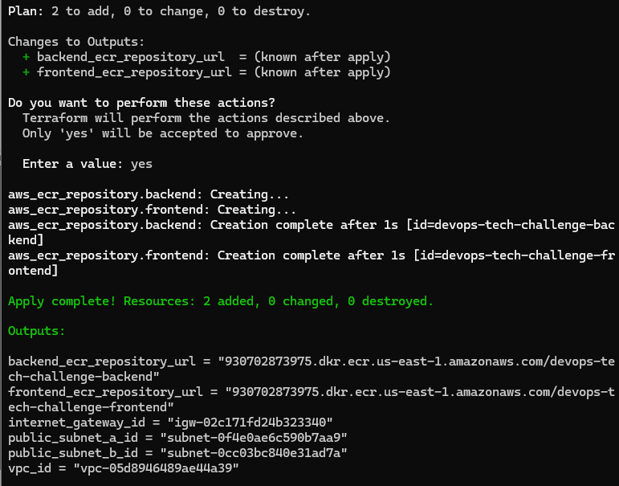

Docker images were then pushed to ECR:

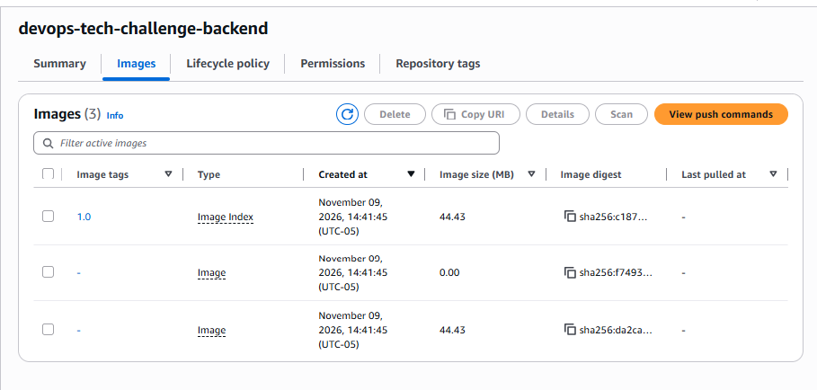

ECR acts as the private image registry used by ECS Fargate.

---

# 6. Application Load Balancer

The application uses an internet-facing Application Load Balancer named:

```text
devops-tech-challenge-alb
```

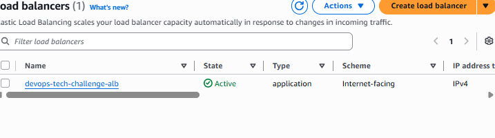

## Routing

The ALB listener accepts HTTP traffic on port 80.

Routing behavior:

```text
/       -> Frontend Target Group -> Frontend ECS Service
/api/*  -> Backend Target Group  -> Backend ECS Service
```

The frontend target group uses port 80.

The backend target group uses port 8080.

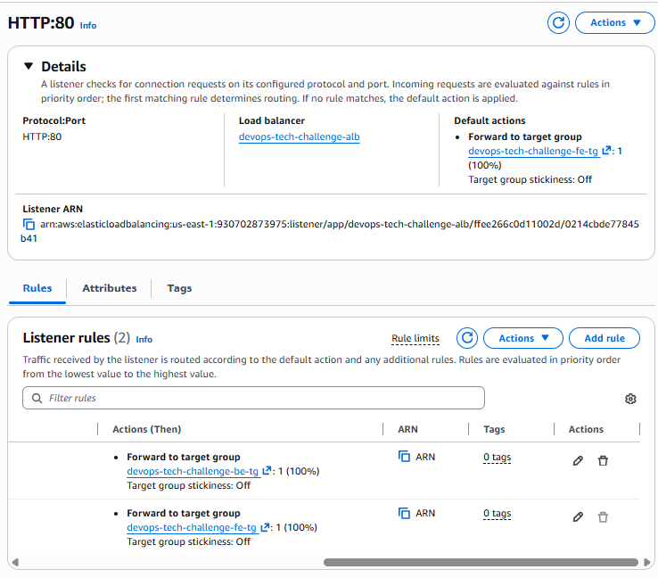

This lets the user access one public endpoint while the ALB decides whether the request belongs to the React frontend or Express backend.

---

# 7. Amazon ECS and AWS Fargate

The ECS cluster is:

```text
devops-tech-challenge-cluster
```

Terraform created the ECS cluster, CloudWatch log groups, task definitions, and execution role:

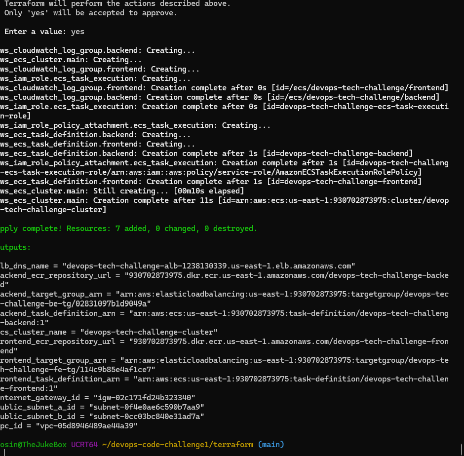

## Frontend task definition

```text
Launch type: Fargate
CPU: 512 units / 0.5 vCPU
Memory: 1024 MiB / 1 GB
Container port: 80
```

## Backend task definition

```text
Launch type: Fargate
CPU: 512 units / 0.5 vCPU
Memory: 1024 MiB / 1 GB
Container port: 8080
```

## ECS services

Two ECS services run independently:

```text
devops-tech-challenge-frontend-service
devops-tech-challenge-backend-service
```

After troubleshooting, both services reached a healthy state with one task running each:

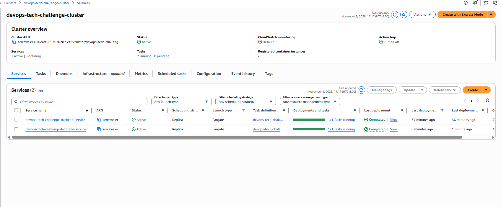

---

# 8. CloudWatch Logging and Troubleshooting

CloudWatch log groups are configured for both containers:

```text
/ecs/devops-tech-challenge/frontend
/ecs/devops-tech-challenge/backend
```

One important failure occurred during the first ECS frontend deployment.

The original Nginx configuration contained:

```text
devops-backend
```

as an upstream Docker hostname.

That hostname worked on the local Docker network because Docker could resolve the container name. In ECS, the frontend and backend were separate Fargate tasks and that local Docker hostname did not exist.

CloudWatch exposed the failure clearly:

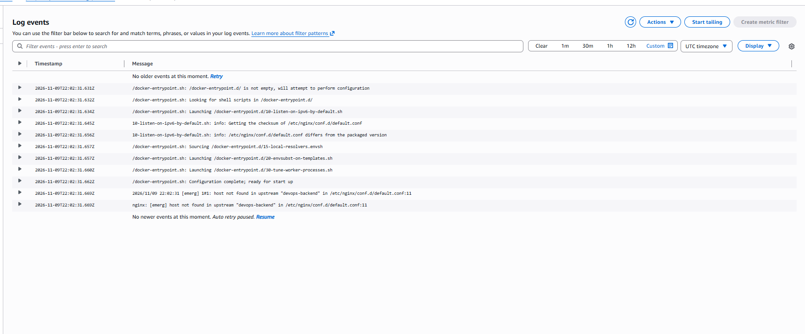

The key error was:

```text
host not found in upstream "devops-backend"
```

## Resolution

I removed the Docker-local backend proxy from the frontend Nginx configuration and allowed Nginx to focus only on serving the React application.

The frontend continues to call:

```text
/api/
```

The Application Load Balancer now owns the production routing decision:

```text
/api/* -> backend target group
```

This separated local container networking from AWS application routing and allowed the ECS frontend service to become healthy.

---

# 9. Public Application Validation

After the ECS services became healthy, the application was tested through the public ALB.

## Frontend

Public URL:

```text
http://devops-tech-challenge-alb-1238130339.us-east-1.elb.amazonaws.com
```


The React frontend successfully displayed a GUID returned by the backend.

## Backend API

API URL:

```text
http://devops-tech-challenge-alb-1238130339.us-east-1.elb.amazonaws.com/api/
```

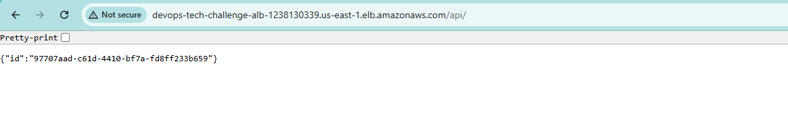

The frontend and backend returned the same GUID, proving the ALB path rule correctly routed `/api/*` traffic to the backend service.

---

# 10. ECS Service Auto Scaling

Both ECS services use Application Auto Scaling with target tracking.

Configuration:

```text
Minimum tasks: 1
Maximum tasks: 4
Target metric: ECSServiceAverageCPUUtilization
Target CPU: 50%
Scale-out cooldown: 60 seconds
Scale-in cooldown: 60 seconds
```

The backend scaling policy was active:

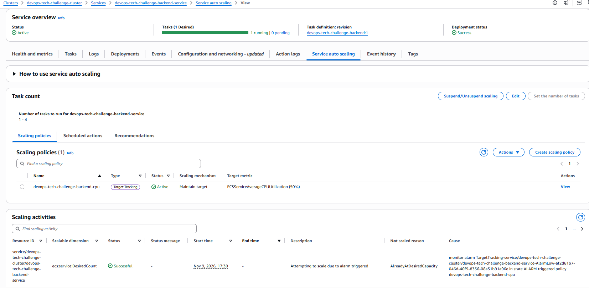

## Before load testing

The backend started with one desired and one running task:

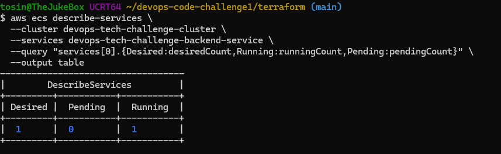

## Scale-out test

Load was generated against the backend API.

As CPU utilization increased, ECS Service Auto Scaling increased the backend service from one task to four running tasks:

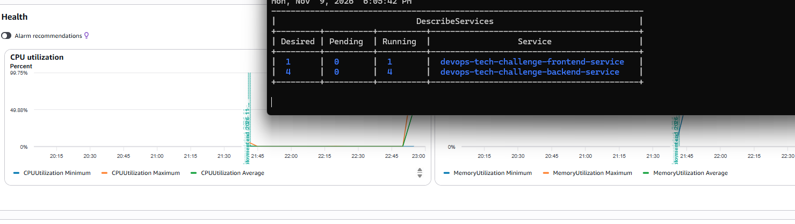

This demonstrated horizontal scale-out under CPU pressure.

## Scale-in validation

After the load stopped and CPU utilization remained low, ECS eventually reduced the backend service back to its minimum capacity of one task:

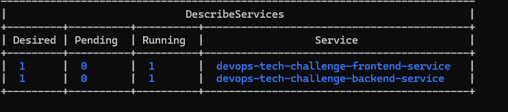

The completed test proved the lifecycle:

```text
1 task
  |
  | CPU load increases
  v
2 tasks
  |
  v
4 tasks
  |
  | load ends / CPU falls
  v
1 task
```

---

# 11. GitHub Actions GitOps Pipeline

The final CI/CD implementation uses **GitHub Actions**, not Jenkins.

The deployment workflow is:

```text
.github/workflows/deploy-ecs.yml
```

It runs when code is pushed to:

```text
gitops
```

## GitHub OIDC Authentication

GitHub Actions authenticates to AWS using OpenID Connect.

The workflow requests:

```yaml
permissions:
  id-token: write
  contents: read
```

GitHub then assumes this AWS IAM role:

```text
devops-tech-challenge-github-actions-role
```

This avoids storing permanent AWS access keys in GitHub.

OIDC authentication was validated successfully:

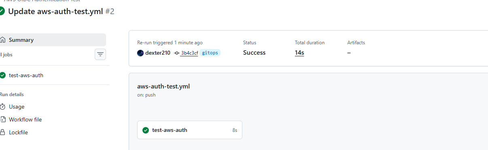

## Deployment pipeline

For each push to `gitops`, GitHub Actions performs:

1. Checkout repository.
2. Request an OIDC token.
3. Assume the AWS deployment IAM role.
4. Login to Amazon ECR.
5. Build the frontend Docker image.
6. Build the backend Docker image.
7. Tag the images with the first seven characters of the Git commit SHA.
8. Push both images to ECR.
9. Read the current ECS task definitions.
10. Replace the container image references.
11. Register new frontend and backend task definition revisions.
12. Update both ECS services.
13. Wait until both services are stable.
14. Report deployment completion.

The Git commit SHA makes each CI/CD image traceable back to the source commit that produced it.

## Successful GitOps deployment

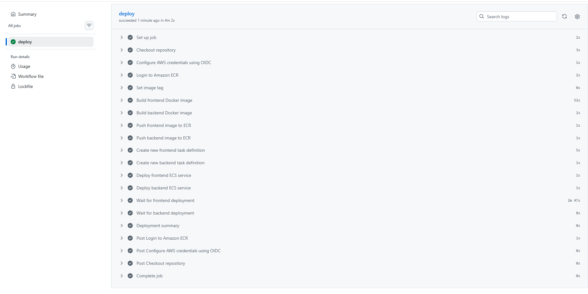

The successful workflow proves the automated path:

```text
git push
   |
   v
GitHub Actions
   |
   v
OIDC -> AWS IAM
   |
   v
Docker Build
   |
   v
Amazon ECR
   |
   v
New ECS Task Definition Revisions
   |
   v
ECS Service Rolling Deployment
   |
   v
Stable Fargate Services
```

---

# 12. Security Decisions

The project includes several security-focused implementation choices.

## Short-lived CI/CD authentication

GitHub Actions uses OIDC instead of storing long-lived AWS access keys.

## Least-privilege deployment role

The GitHub Actions IAM role is limited to the ECR, ECS, and `iam:PassRole` permissions required for deployment.

## Restricted ECS ingress

The ECS security group accepts frontend and backend application traffic only from the ALB security group.

## Dedicated ECS execution role

ECS tasks use a dedicated task execution role to retrieve container images and write logs.

## Sensitive Terraform files excluded

Terraform state files and the local `.terraform/` provider directory are excluded from Git.

## Private image registry

Application images are stored in private ECR repositories.

---

# 13. Reproducing the Deployment

A new deployment can be reproduced in this order.

## Step 1 — Clone and select the GitOps branch

```bash
git clone https://github.com/dexter210/devops-ecs-tech-challenge.git
cd devops-ecs-tech-challenge
git checkout gitops
```

## Step 2 — Validate locally

Backend:

```bash
cd backend
npm ci
npm start
```

Frontend in another terminal:

```bash
cd frontend
npm ci
npm start
```

## Step 3 — Build Docker images

From the repository root:

```bash
docker build -t devops-backend:1.0 ./backend
docker build -t devops-frontend:3.0 ./frontend
```

## Step 4 — Configure AWS CLI

```bash
aws configure
aws sts get-caller-identity
```

The AWS identity used for Terraform must have permission to create the resources defined in `terraform/`.

## Step 5 — Initialize Terraform

```bash
cd terraform
terraform init
terraform validate
```

## Step 6 — Create ECR repositories

```bash
terraform apply \
  -target=aws_ecr_repository.frontend \
  -target=aws_ecr_repository.backend
```

## Step 7 — Push the bootstrap images

```bash
aws ecr get-login-password --region us-east-1 | \
docker login --username AWS --password-stdin 930702873975.dkr.ecr.us-east-1.amazonaws.com

docker tag devops-frontend:3.0 \
930702873975.dkr.ecr.us-east-1.amazonaws.com/devops-tech-challenge-frontend:3.0

docker tag devops-backend:1.0 \
930702873975.dkr.ecr.us-east-1.amazonaws.com/devops-tech-challenge-backend:1.0

docker push 930702873975.dkr.ecr.us-east-1.amazonaws.com/devops-tech-challenge-frontend:3.0
docker push 930702873975.dkr.ecr.us-east-1.amazonaws.com/devops-tech-challenge-backend:1.0
```

## Step 8 — Deploy AWS infrastructure

```bash
terraform plan
terraform apply
```

## Step 9 — Obtain the ALB endpoint

```bash
terraform output
```

Use the `alb_dns_name` output in a browser.

## Step 10 — Configure GitHub OIDC

Create an IAM OIDC provider for:

```text
https://token.actions.githubusercontent.com
```

with audience:

```text
sts.amazonaws.com
```

Create an IAM role named:

```text
devops-tech-challenge-github-actions-role
```

The role must trust the repository's GitHub OIDC identity and have the ECR/ECS deployment permissions required by `.github/workflows/deploy-ecs.yml`.

## Step 11 — Deploy through GitHub Actions

Push a commit to the `gitops` branch:

```bash
git add .
git commit -m "deploy: update application"
git push origin gitops
```

GitHub Actions will automatically build, push, register, and deploy the new application revision.

---

# 14. Cost Management

This project uses AWS resources that may generate charges, including:

- Application Load Balancer
- ECS Fargate tasks
- CloudWatch logs
- ECR image storage
- network data transfer

The environment should be destroyed when no longer needed.

To remove Terraform-managed infrastructure:

```bash
cd terraform
terraform destroy
```

Before destroying, confirm that any manually created GitHub OIDC/IAM resources are also removed if they are no longer required.

ECR repositories may need to be emptied before Terraform can delete them if they contain images.

---

# 15. Key Results

The completed project demonstrates:

- React and Express application validation
- Docker containerization
- multi-stage frontend image builds
- Terraform Infrastructure as Code
- AWS VPC networking
- security-group segmentation
- private ECR repositories
- ECS Fargate task definitions and services
- Application Load Balancer path routing
- CloudWatch logging and troubleshooting
- CPU-based ECS Service Auto Scaling
- successful scale-out from 1 to 4 tasks
- successful scale-in from 4 back to 1 task
- GitHub OIDC authentication to AWS
- GitHub Actions GitOps deployment
- commit-SHA container image tagging
- automated ECS task definition revisions and service deployments

---

# Submission

## GitHub Repository

```text
https://github.com/dexter210/devops-ecs-tech-challenge
```


## Public Frontend

```text
http://devops-tech-challenge-alb-1238130339.us-east-1.elb.amazonaws.com
```

## Public API

```text
http://devops-tech-challenge-alb-1238130339.us-east-1.elb.amazonaws.com/api/
```

## Final Status

**Dockerized application:** Complete  
**Terraform infrastructure:** Complete  
**ECS Fargate deployment:** Complete  
**Application Load Balancer routing:** Complete  
**CloudWatch troubleshooting:** Complete  
**Auto scaling validation:** Complete  
**GitHub OIDC authentication:** Complete  
**GitHub Actions GitOps deployment:** Complete
